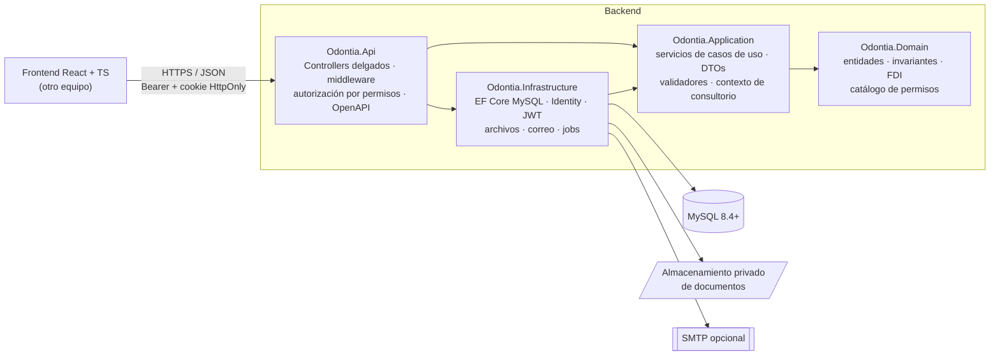
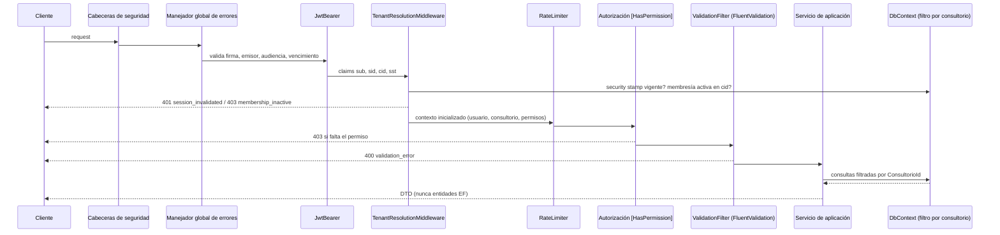

# Arquitectura

## Capas y dependencias

- **Domain** no depende de EF Core ni de ASP.NET (sólo de `Microsoft.Extensions.Identity.Stores` para `IdentityUser<Guid>`).
  Las reglas viven en las entidades: máquina de estados de turnos y laboratorio, versionado de evoluciones clínicas,
  reglas del odontograma, totales de presupuestos, anulación de pagos, etc.
- **Application** define los puertos (`IApplicationDbContext`, `IFileStorage`, `IEmailSender`, `IAgendaLock`, …) y los
  servicios de casos de uso. Usa `IApplicationDbContext` directamente (sin repositorios genéricos: EF Core ya es unidad de
  trabajo + repositorio). Cada servicio vuelve a verificar permisos (defensa en profundidad).
- **Infrastructure** implementa los puertos.
- **Api** sólo traduce HTTP ↔ casos de uso. Los controllers no contienen consultas ni lógica de negocio.

## Pipeline de una solicitud

## Multi-consultorio (aislamiento)

1. **El consultorio activo viaja en el JWT (`cid`)**, emitido por el servidor sólo si el usuario es miembro activo.
   Cambiarlo requiere `POST /auth/switch-consultorio`, que vuelve a verificar la membresía. Nunca se acepta un
   `ConsultorioId` del cuerpo/query como fuente de verdad.
2. **En cada solicitud** `TenantResolutionMiddleware` relee la membresía, su estado y sus permisos desde la base
   (una revocación o desactivación tiene efecto inmediato).
3. **Filtro global de EF Core** en todas las entidades `ITenantEntity`: `ConsultorioId == consultorio activo`.
   Sin consultorio activo no se ve ningún dato de consultorio. Un recurso de otro consultorio responde **404**.
4. **Escrituras**: `SaveChanges` asigna el consultorio activo a las altas y rechaza altas/modificaciones/bajas sobre otro
   consultorio, o el cambio de `ConsultorioId`.
5. **Integridad referencial por consultorio**: las relaciones entre entidades de consultorio usan **FK compuestas**
   `(ConsultorioId, XId) → (ConsultorioId, Id)`. La base de datos impide, por ejemplo, un turno del consultorio A con un
   paciente del B. Los profesionales se referencian con `(ConsultorioId, ProfessionalUserId) → ConsultorioMembers(ConsultorioId, UserId)`:
   sólo un miembro de ese consultorio puede ser profesional de sus turnos, evoluciones, odontograma, etc.
6. **Trabajos en segundo plano** (recordatorios, vencimientos de presupuestos, tareas y laboratorio) recorren los consultorios
   y ejecutan cada uno en su propio scope con `InitializeBackground(consultorioId)`, así que aplican el mismo filtro.

## Concurrencia

- **Reservas de turnos**: dentro de una transacción `READ COMMITTED` se ejecuta un `UPDATE` sobre la fila del profesional
  (y del gabinete), que toma un bloqueo exclusivo de InnoDB. Después se revalida la disponibilidad y se inserta. Dos reservas
  simultáneas del mismo profesional quedan serializadas y la segunda ve la primera. Verificado con 6 reservas en paralelo
  contra MySQL: se crea 1 y las otras 5 reciben 409.
- **Optimista**: los turnos tienen `Version` y las evoluciones clínicas `Version`. Una edición con versión vieja → 409.
- **Numeración** (presupuestos, recibos): contador por consultorio incrementado con `UPDATE … SET LastValue = LastValue + 1`.
- **Login concurrente**: el "último acceso" se actualiza con un `UPDATE` atómico, sin el `ConcurrencyStamp` de Identity.
- No se usa `EnableRetryOnFailure`: es incompatible con transacciones explícitas, y reintentar una reserva a ciegas no es
  seguro. Ante errores transitorios el cliente reintenta la operación completa.

## Fechas y zonas horarias

Todo `DateTime` se persiste en **UTC** (conversor global). Cada consultorio tiene `TimeZoneId` (IANA, p. ej.
`America/Argentina/Buenos_Aires`). Los horarios laborales se guardan en hora local y la agenda/disponibilidad se calcula en
la zona del consultorio. La API recibe `DateTimeOffset` (ISO 8601 con offset) y devuelve UTC (`...Z`).
Fechas de calendario (`DateOnly`) y horas (`TimeOnly`) se guardan como `date`/`time`.

## Decisiones técnicas relevantes

| Decisión | Motivo |
|---|---|
| GUID v7 generados en el dominio, `char(36)` | Estrategia uniforme, ordenables por tiempo, sin colisiones entre consultorios |
| Identity con `IdentityUserContext` (sin tablas de roles de Identity) | Roles y permisos propios por consultorio; Identity sólo gestiona usuarios, contraseñas, lockout, tokens y 2FA |
| Permisos resueltos por solicitud, no dentro del JWT | Revocación inmediata y tokens chicos |
| Proveedor `MySql.EntityFrameworkCore` (Oracle) | Exigido por los requisitos. Lee `date`/`time` como `DateTime`/`TimeSpan`, por eso hay conversores explícitos |
| Sin `HasData` para usuarios | No existen credenciales fijas en el código |
| Historia clínica sin `UPDATE` silencioso | Correcciones con motivo → `ClinicalEntryRevisions` + auditoría; anulación en lugar de borrado |
| Pagos sin `DELETE` | Anulación + contraasiento en `AccountMovements` (libro inmutable) |
| Documentos fuera de MySQL | `IFileStorage` privado (local en desarrollo); en MySQL sólo metadatos, hash SHA-256 y clave de almacenamiento |
