# Base de datos

MySQL 8.4 LTS o superior, InnoDB, `utf8mb4_0900_ai_ci`. Migración inicial: `InitialCreate` (53 tablas + `__EFMigrationsHistory`,
134 claves foráneas, verificada contra MySQL 9.1).

## Convenciones

- **Claves primarias**: GUID v7 (`char(36)`) generados en el dominio. Excepciones: tablas de referencia FDI (`DentalPieces.Code`,
  `DentalSurfaces.Code`) y tablas puente con clave compuesta.
- **Aislamiento**: toda tabla de consultorio tiene `ConsultorioId` y una clave alternativa única `(ConsultorioId, Id)`. Las
  relaciones entre tablas de consultorio son **FK compuestas** `(ConsultorioId, XId)`, así que no son posibles referencias cruzadas.
- **Auditoría de fila**: `CreatedAtUtc`, `CreatedByUserId`, `UpdatedAtUtc`, `UpdatedByUserId` (completados automáticamente).
- **Fechas**: `datetime(6)` en UTC; `date` para fechas de calendario; `time` para horarios laborales.
- **Importes**: `decimal(14,2)`; porcentajes `decimal(5,2)`.
- **Textos**: longitudes acotadas (`varchar(n)`); textos clínicos largos en `text`.
- **Borrado**: `ON DELETE RESTRICT` en relaciones de negocio. No hay borrado físico de registros clínicos ni financieros.
- Nombres de restricciones de más de 64 caracteres se truncan de forma determinística (límite de MySQL).

## Diagrama entidad-relación (principal)

```mermaid
erDiagram
    Consultorios ||--o{ ConsultorioMembers : tiene
    AspNetUsers ||--o{ ConsultorioMembers : pertenece
    ConsultorioMembers ||--o{ MemberRoles : asigna
    Roles ||--o{ MemberRoles : ""
    Roles ||--o{ RolePermissions : agrupa
    Consultorios ||--o{ Invitations : emite
    AspNetUsers ||--o{ RefreshTokens : sesiones
    Consultorios ||--o{ Gabinetes : posee

    Consultorios ||--o{ Patients : atiende
    HealthInsurances ||--o{ Patients : cubre
    Patients ||--|| MedicalHistories : antecedentes
    Patients ||--o{ PatientAlerts : alertas

    ConsultorioMembers ||--o{ WorkingHours : "horario (profesional)"
    ConsultorioMembers ||--o{ ScheduleBlocks : bloqueos
    Patients ||--o{ Appointments : turnos
    ConsultorioMembers ||--o{ Appointments : "profesional"
    Gabinetes ||--o{ Appointments : sala
    Appointments ||--o{ AppointmentHistories : historial
    ConsultorioMembers ||--o{ Tasks : responsable

    Patients ||--|| ClinicalRecords : historia
    ClinicalRecords ||--o{ ClinicalEntries : evoluciones
    ClinicalEntries ||--o{ ClinicalEntryRevisions : versiones
    ClinicalEntries ||--o{ ClinicalEntryTeeth : piezas
    Patients ||--o{ Diagnoses : diagnosticos

    Patients ||--|| Odontograms : odontograma
    Odontograms ||--o{ ToothFindings : hallazgos
    Odontograms ||--o{ OdontogramHistory : historial
    Odontograms ||--o{ ToothNotes : notas
    DentalPieces ||--o{ ToothFindings : pieza
    DentalSurfaces ||--o{ ToothFindings : superficie
    OdontogramConditions ||--o{ ToothFindings : condicion

    Procedures ||--o{ TreatmentPlanItems : prestacion
    Patients ||--o{ TreatmentPlans : planes
    TreatmentPlans ||--o{ TreatmentPlanItems : items
    TreatmentPlans ||--o{ TreatmentChanges : historial

    Patients ||--o{ Budgets : presupuestos
    TreatmentPlans |o--o{ Budgets : origen
    Budgets ||--o{ BudgetItems : lineas
    Budgets ||--o{ BudgetStatusChanges : historial
    Patients ||--o{ Payments : pagos
    Budgets |o--o{ Payments : imputa
    Patients ||--o{ AccountMovements : "cuenta corriente"

    Laboratories ||--o{ LabWorks : trabajos
    Patients ||--o{ LabWorks : ""
    LabWorks ||--o{ LabWorkStatusChanges : historial

    Patients ||--o{ Documents : documentos
    Patients ||--o{ Consents : consentimientos
    Documents |o--o{ Consents : "firmado adjunto"

    AspNetUsers ||--o{ Notifications : recibe
```

## Tablas por módulo

| Módulo | Tablas | Restricciones relevantes |
|---|---|---|
| Identity / sesiones | `AspNetUsers`, `AspNetUserClaims`, `AspNetUserLogins`, `AspNetUserTokens`, `RefreshTokens`, `UserNotificationSettings` | Email único normalizado; `RefreshTokens.TokenHash` único (sólo hash SHA-256) |
| Organización | `Consultorios`, `Gabinetes`, `ConsultorioMembers`, `Roles`, `RolePermissions`, `MemberRoles`, `Invitations`, `InvitationRoles`, `ConsultorioSequences` | Miembro único `(ConsultorioId, UserId)`; nombre de rol único por consultorio; `Invitations.TokenHash` único |
| Pacientes | `Patients`, `MedicalHistories`, `PatientAlerts`, `HealthInsurances` | **DNI único por consultorio** `(ConsultorioId, DocumentNumber)`; índices de búsqueda por nombre normalizado y teléfono |
| Agenda | `WorkingHours`, `ScheduleBlocks`, `Appointments`, `AppointmentHistories`, `Tasks` | Índices `(ConsultorioId, ProfessionalUserId, StartUtc)`, `(ConsultorioId, GabineteId, StartUtc)`, `(ConsultorioId, PatientId, StartUtc)`; token de concurrencia `Appointments.Version` |
| Clínica | `ClinicalRecords`, `ClinicalEntries`, `ClinicalEntryTeeth`, `ClinicalEntryRevisions`, `Diagnoses` | Una historia por paciente; revisión única `(ClinicalEntryId, Version)`; piezas con FK a `DentalPieces` |
| Odontograma | `DentalPieces` (52 FDI), `DentalSurfaces` (7), `OdontogramConditions`, `Odontograms`, `ToothFindings`, `OdontogramHistory`, `ToothNotes` | Un odontograma por paciente; código de condición único por consultorio; hallazgos normalizados por pieza/superficie |
| Tratamientos | `Procedures`, `TreatmentPlans`, `TreatmentPlanItems`, `TreatmentChanges` | Código de prestación único por consultorio; precio histórico en el ítem |
| Finanzas | `Budgets`, `BudgetItems`, `BudgetStatusChanges`, `Payments`, `AccountMovements` | Número de presupuesto y de recibo únicos por consultorio; movimientos inmutables con contraasiento `ReversesMovementId` |
| Laboratorio | `Laboratories`, `LabWorks`, `LabWorkStatusChanges` | Nombre de laboratorio único por consultorio |
| Documentos | `Documents`, `Consents` | `StorageKey` único; hash SHA-256; baja lógica (`IsDeleted`) |
| Notificaciones | `Notifications`, `OutboundMessages` | Estado real de entrega (`Sent` sólo con confirmación del proveedor) |
| Auditoría | `AuditLogs` | Índices por consultorio/fecha, entidad y usuario |

## Modelo del odontograma

Diseño normalizado, sin imágenes ni JSON libre:

- `ToothFindings`: una fila por **condición** sobre una **pieza** (FDI) y opcionalmente una **superficie**, con estado
  `Existing` (existente) o `Planned` (a realizar), profesional, fecha y vínculo opcional a una prestación del plan.
  `IsCurrent` indica si está vigente. Al resolverla, realizarla o reemplazarla se cierra (`ClosedAtUtc`, `ClosedReason`,
  `SupersededByFindingId`) y la fila **no se borra**.
- **Estado actual** = filas con `IsCurrent = 1`. **Historial** = `OdontogramHistory`: una entrada inmutable por cambio
  (Added/Resolved/Removed/Completed/NoteAdded) con profesional, paciente, consultorio y fecha.
- Las condiciones son configurables (`OdontogramConditions`): 11 de sistema (caries, obturación, sellante, corona, endodoncia,
  extracción, ausente, implante, fractura, prótesis, resto radicular) más las propias de cada consultorio.

## Semillas (controladas por migración)

- Roles de sistema `Administrador`, `Odontólogo`, `Secretaria` y sus permisos (`RolePermissions`).
- 52 piezas dentales FDI, 7 superficies y 11 condiciones de sistema.
- **No se siembran usuarios**: el primer administrador se registra por la API.

## Política de retención de datos

Ver [SECURITY.md](SECURITY.md#política-de-retención-de-datos).
